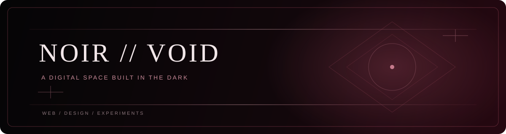

### A quieter corner of the internet.

**NOIR // VOID** is a web project with a dark, minimal visual identity.

[Open the repository](https://github.com/NotAsh01/noir-void-site)

---

## Project

This repository contains the official website for NOIR // VOID.

## Design language

- Near-black surfaces and restrained contrast
- Muted silver typography
- Deep crimson accents
- Minimal layout with a focus on atmosphere

## Development

The site is built with the files in this repository. Open `index.html` locally to preview the current experience.

---

NOIR // VOID · Designed in the dark.

